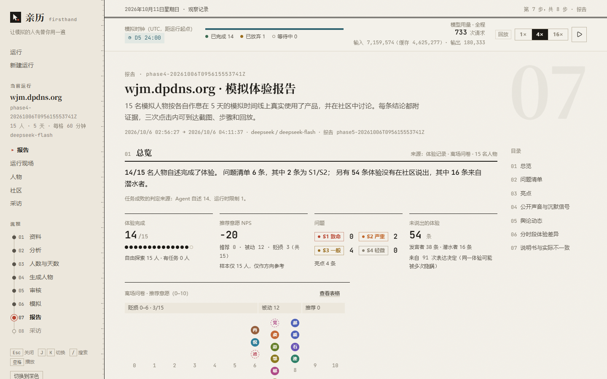
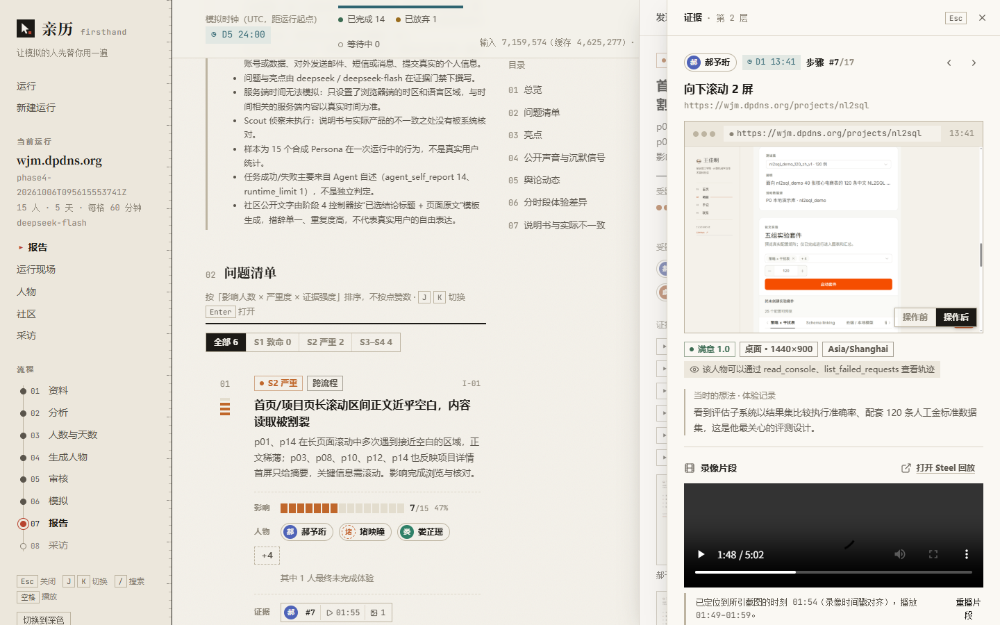
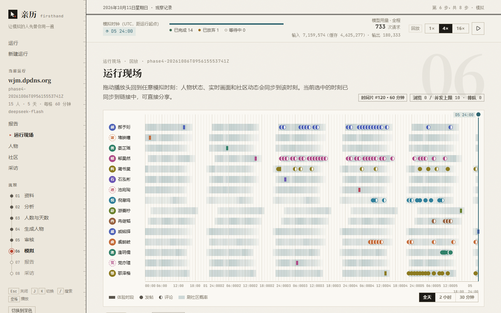
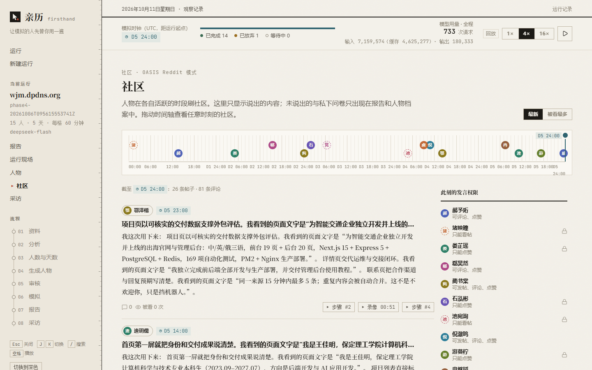
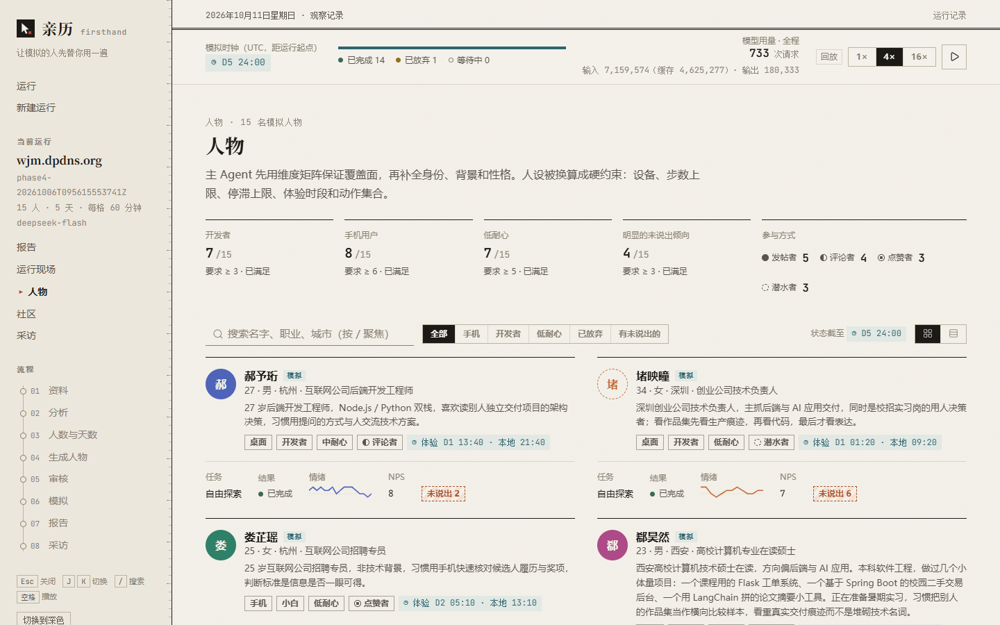

<p align="center">
  
</p>

<h1 align="center">亲历 · firsthand</h1>

<p align="center">
  让一群 AI 用户<b>真的用一遍</b>你的产品，再告诉你他们说了什么——以及没说什么。
</p>

<p align="center">
  <a href="README.md">English</a> · <b>简体中文</b>
</p>

<p align="center">
  
  
  
</p>

<p align="center">
  
</p>

---

## 这是什么

**亲历**是一个多 Agent 产品体验模拟器。你提供自己产品的网址（以及可选的使用说明），主 Agent 会生成一批身份、背景、性格和作息各不相同的 Persona。他们在模拟时间线上，于各自的时段内用**云端真实浏览器**操作你的产品，再到一个类 Reddit 的社区里讨论。最后，系统输出一份**每条结论都附证据**的产品优缺点报告。

整体流程参考了 [MiroFish](https://github.com/666ghj/MiroFish)。核心区别是：MiroFish 的 Agent 根据材料“想象”，亲历的 Agent 根据“亲身经历”发言或保持沉默。

### 核心原则

1. **没体验过就不能发言。** 每个 Agent 都必须真实用过产品；没有通过校验的体验，只能看帖。
2. **观察权限因人而异。** 底层采集全部数据（截图、DOM、Console、Network），但每个 Persona 只能看到与其身份相符的部分，例如非开发者看不到控制台。
3. **每条结论都可追溯。** 报告里的问题与亮点必须引用截图、步骤或原话，没有证据的结论不会写进报告。
4. **说出来的 ≠ 体验到的。** 有人会隐瞒感受，有人只潜水。报告同时呈现“公开声音”和“沉默信号”（离场私密问卷、被隐瞒的内容）。
5. **模型能力以实测为准。** 每次运行前先探测工具调用、结构化输出、识图、上下文和并发，不相信模型的自我声明。

## 功能

- **最少只需一个网址**：说明书只有 `url` 与 `allowed_domains` 是必填；资料越少，界面与报告越明确地标注“参考性有限”。
- **主 Agent 推荐规模**：推荐人数（2–99）与模拟天数（1–365），用户确认或修改后再生成人物。
- **多维 Persona**：维度矩阵保证覆盖面（年龄、职业、设备、技术水平、耐心、动机、作息、参与方式、表达意愿……），每个人物还有由性格推出的独立采样参数。
- **人工审核关卡**：人物、作息和运行配置须经你批准才会开始产生浏览和讨论费用。
- **真实浏览**：[Browser Use](https://github.com/browser-use/browser-use) + [Steel](https://steel.dev) 云端浏览器，每人独立会话，自带录像；域名白名单、禁止动作和测试账号注入都有门禁。
- **社交讨论**：[OASIS](https://github.com/camel-ai/oasis) Reddit 模式，体验与讨论按时间片交织；有人发帖、有人评论、有人只点赞、有人潜水。
- **Report Agent**：问题清单与亮点由模型撰写，并通过证据门禁（引用存在、引文为原文、类型匹配）；其余章节由代码从完整记录生成。
- **Web UI**：新建运行 → 审核 → 实时进度 → 报告；在报告里点问题即可跳到对应的录像片段与截图，并查看 Console / Network 摘要。
- **采访**：可以对任意 Persona 单独追问，回答引用其体验证据。
- **多模型提供商**：通用 OpenAI 兼容、DeepSeek、小米 MiMo 适配器；支持 Chat Completions 与 Responses 接口；不支持识图的纯文本模型也能跑完全程（结果标注参考性有限）。

## 截图

> 来自一次真实运行：对作者个人网站模拟 15 名人物、5 天。

**证据下钻**。点开一条问题，再点开一条证据：可以看到该人物操作前后的截图、当时的想法，以及对准这一刻的录像片段。



| 运行现场 | 社区 |
|---|---|
|  |  |
| **所有人物的体验时段、发帖和评论在同一条时间线上，拖动播放头可回放任意时刻。** | **公开说出的内容，以及谁只能看帖或点赞。** |

**人物**。维度矩阵的覆盖情况，以及每个人物的结果、情绪曲线、NPS 和没说出口的内容。



## 工作流程

```
⓪ 模型能力探测   → 工具调用不支持则中止；识图不支持则需确认“参考性有限”后继续
① 读取说明书     → 校验 → 主 Agent 解析出产品模型（只填网址时会读取网站首页）
② 生成 Persona、作息与运行配置 →【人工审核】
③ 时间线模拟（每个时间片）
     a. 到了体验时段的 Persona 用云端浏览器真实使用产品 → Experience Memory（附证据）
     b. 活跃的 Agent 在 OASIS 中行动：看帖 / 发帖 / 评论 / 点赞 / 什么都不做
④ 离场问卷       → 所有人私下作答，包括潜水者和隐瞒者
⑤ Report Agent   → 公开声音 + 沉默信号，每条附证据
⑥ 采访           → 单独追问任意 Persona
```

## 快速开始

### 环境要求

| 组件 | 要求 |
|---|---|
| Python | 3.12（浏览、接口）与 3.11（OASIS；`camel-oasis` 要求 `<3.12`），推荐用 [uv](https://github.com/astral-sh/uv) 管理 |
| Node.js | 20.19+ 或 22.12+（Vite 8 的要求） |
| 模型 | 一个 OpenAI 兼容端点，**必须支持工具调用**；推荐支持识图 |
| 浏览器 | [Steel](https://steel.dev) API Key（云端浏览器与录像） |

### 1. 克隆并创建两个 Python 环境

浏览与 OASIS 依赖冲突，因此使用两个虚拟环境，都放在 `backend/` 里：

```bash
git clone https://github.com/JiaMingWang-CN/firsthand.git
cd firsthand/backend
uv venv --python 3.12 .venv-browsing
uv venv --python 3.11 .venv-oasis
```

Windows：

```powershell
uv pip sync --python .venv-browsing/Scripts/python.exe browsing/requirements.lock.txt
uv pip sync --python .venv-oasis/Scripts/python.exe discussion/requirements.lock.txt
```

macOS / Linux：

```bash
uv pip sync --python .venv-browsing/bin/python browsing/requirements.lock.txt
uv pip sync --python .venv-oasis/bin/python discussion/requirements.lock.txt
```

### 2. 配置

```bash
cp config/.env.example config/.env
```

至少填写以下几项（完整说明见 [`backend/config/.env.example`](backend/config/.env.example) 与 [`docs/providers.md`](docs/providers.md)）：

| 变量 | 说明 |
|---|---|
| `LLM_PROVIDER` | `openai_compatible` / `deepseek` / `mimo` |
| `LLM_BASE_URL`、`LLM_API_KEY`、`LLM_MODEL` | 模型端点、密钥与模型名 |
| `LLM_API` | `chat_completions` 或 `responses` |
| `LLM_THINKING_TYPE` | `enabled` / `disabled`，留空用服务端默认 |
| `LLM_MAX_CONCURRENCY`、`BROWSER_MAX_CONCURRENCY` | 模型与浏览器的全局并发上限（跨进程共享） |
| `STEEL_API_KEY` | Steel 云端浏览器 |
| `TEST_ACCOUNT_<角色>_USERNAME` / `_PASSWORD` | 可选：说明书中声明的测试账号，只通过域名限定的方式注入浏览器 |

`config/.env` 已被 `.gitignore` 排除，请勿提交。

### 3. 安装前端并启动

在仓库根目录：

```bash
npm --prefix frontend install
npm run dev
```

这会同时启动后端接口（`127.0.0.1:8000`）与前端（<http://localhost:5180>）。在界面中点“新建运行”，填入网址即可开始：分析资料 → 确认人数与天数 → 生成人物 → 审核批准 → 模拟体验与讨论 → 查看报告。

> 第一次运行建议先跑能力探测，确认模型、Steel 与 OASIS 三项连通（在 `backend/` 下）：
>
> ```bash
> .venv-browsing/Scripts/python.exe -m orchestrator.phase0
> ```

## 命令行用法

所有命令都在 `backend/` 下执行（macOS / Linux 把 `Scripts/python.exe` 换成 `bin/python`）：

```powershell
# ⓪ 模型能力探测（模型 / Browser Use + Steel / OASIS 三项）
.venv-browsing/Scripts/python.exe -m orchestrator.phase0

# ① 校验说明书；② 生成人物草稿（含审核所需的全部材料）
.venv-browsing/Scripts/python.exe -m orchestrator.phase1 validate path/to/manual.md
.venv-browsing/Scripts/python.exe -m orchestrator.phase1 prepare  path/to/manual.md

# ③④ 时间线模拟（体验 + 讨论 + 离场问卷），需要已批准的草稿目录
.venv-browsing/Scripts/python.exe -m orchestrator.phase4 runs/<已批准的草稿目录>

# ⑤ 生成报告
.venv-browsing/Scripts/python.exe -m orchestrator.phase5 runs/<模拟目录> --capability-run runs/<能力文件目录>

# 只启动接口（只读运行目录 + 采访），交互式文档在 /api/docs
.venv-browsing/Scripts/python.exe -m api --port 8000
```

各阶段的参数、产物与验收方式见 [`docs/`](docs/)。

## 产品说明书

说明书是带 YAML front matter 的 Markdown，模板见 [`docs/product_manual_template.md`](docs/product_manual_template.md)。最小示例：

```markdown
---
url: https://staging.example.com
allowed_domains:
  - staging.example.com
---
```

正文可选填产品定位、目标用户、核心功能、关键流程和**已知问题**。已知问题用作校准集：如果 Agent 连已知问题都发现不了，说明人设或浏览配置有问题。完整示例见 [`docs/examples/wjm_product_manual.md`](docs/examples/wjm_product_manual.md)（作者的个人网站）。

## 项目结构

```
firsthand/
├── package.json           # npm run dev：同时启动接口和前端
├── scripts/dev.mjs
├── frontend/              # Web UI：Vue 3 + Vite
├── docs/                  # 开发方案、各阶段设计与验收记录、说明书模板
└── backend/               # Python 项目根，所有命令在此执行
    ├── config/            # .env.example
    ├── core/              # 共享数据结构、模型适配器、并发额度、用量
    ├── probe/             # ⓪ 模型能力探测
    ├── orchestrator/      # 主 Agent：说明书解析、Persona 生成、审核、时间线编排
    ├── browsing/          # 浏览执行层（.venv-browsing：browser-use + steel）
    ├── discussion/        # OASIS 讨论（.venv-oasis：camel-oasis）
    ├── report/            # 证据索引、Report Agent、报告渲染
    ├── api/               # FastAPI 接口层：运行目录只读 + 采访 + 任务
    ├── tests/
    └── runs/              # 每次运行的产物（不入库）
```

## 测试

```bash
# 后端（在 backend/ 下）
.venv-browsing/Scripts/python.exe -m pytest tests -q

# 前端（在 frontend/ 下）
npm test
```

测试不调用真实模型或浏览器，无需密钥。

## 费用与安全提示

- **会产生费用。** 一次运行包含大量模型调用（浏览时每一步都可能带截图）和 Steel 浏览器时长。人工审核关卡之前只会产生分析与人物生成的费用；每次运行都会记录请求数与 token 用量（不换算价格）。
- **只测试你有权测试的产品。** 建议使用 staging 环境与专用测试账号。Agent 只能访问 `allowed_domains`；默认禁止真实支付或下单、删除账号或数据、对外发送消息、提交真实个人信息。
- **运行产物是私有数据。** `backend/runs/` 中含会话、录像链接与完整网络轨迹。接口默认只监听 `127.0.0.1` 并只接受本机 Host，请勿对公网开放。
- **模拟不等于真实用户。** 结果用于发现问题和形成假设，不能替代真实用户研究；资料不足或使用纯文本模型时，报告会明确标注参考性有限。

## 已知限制

- 第一版使用单一模型，暂不支持多模型混合，也不包括无障碍（如读屏用户）Persona。
- 只模拟浏览器端时区，无法改变网站服务端的时钟。
- Scout 侦察（用一个浏览会话核对说明书与真实网站）尚未实现。
- 界面与文档目前以中文为主。

更多细节见 [`docs/plan.md`](docs/plan.md) 的风险与对策，以及各阶段文档中的“已知限制”。

## 致谢

- [MiroFish](https://github.com/666ghj/MiroFish) —— 整体流程的灵感来源
- [OASIS](https://github.com/camel-ai/oasis) / [CAMEL](https://github.com/camel-ai/camel) —— 社交模拟
- [Browser Use](https://github.com/browser-use/browser-use) —— 浏览器 Agent
- [Steel](https://steel.dev) —— 云端浏览器与录像

## 许可证

[GNU Affero General Public License v3.0](LICENSE)。如果你修改本项目并通过网络向他人提供服务，需要按 AGPL-3.0 公开相应源代码。
